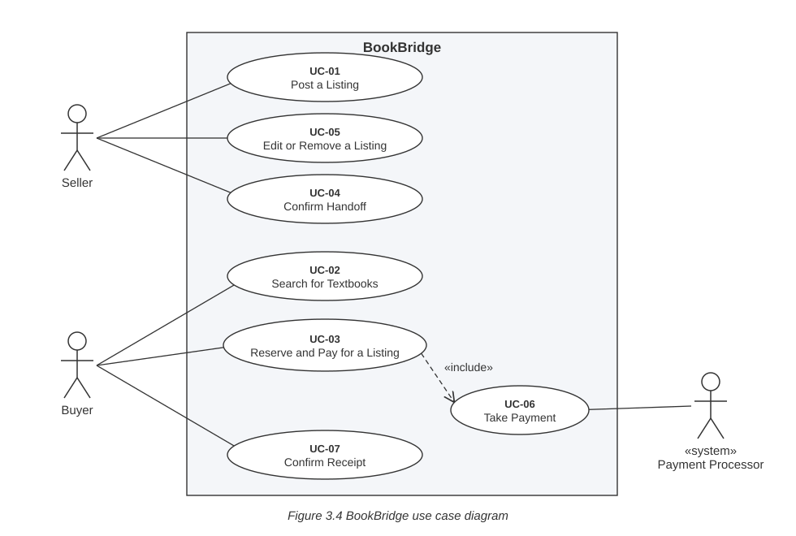

# 3.4 Initial use cases

Changed since v0.3: the full expansions of UC-03 and UC-04 moved to 4.2, and UC-07 Confirm Receipt was added when UC-04 was split so that each use case has one actor (change in 0.2). Signing in through UTD NetID is still a precondition, not a use case (FR-01, CON-01).

*Source: `docs/p2/diagrams/use-case-diagram.svg` (generated by `make_ucd.py`).*

| Use case | Primary actor | TUCBW (begins when) | TUCEW (ends when) |
|---|---|---|---|
| UC-01 Post a Listing | Seller | The Seller asks to post a new textbook listing. | The Seller sees the new listing in their listings with the status Available. |
| UC-02 Search for Textbooks | Buyer | The Buyer searches by course number, title or ISBN. | The Buyer sees the matching Available listings, or that none match. |
| UC-03 Reserve and Pay for a Listing | Buyer | The Buyer asks to reserve an Available listing they found in search. | The Buyer sees that the listing is Reserved for them, with the price paid and the Seller’s UTD email. |
| UC-04 Confirm Handoff | Seller | The Seller reports that the book for one of their Reserved listings has been handed over. | The Seller sees their confirmation recorded. |
| UC-05 Edit or Remove a Listing | Seller | The Seller chooses one of their listings to change or remove. | The Seller sees the updated listing, or that it is no longer listed. |
| UC-06 Take Payment (included by UC-03) | Buyer, with the Payment Processor supporting | UC-03 passes the Buyer to the Payment Processor with the amount due. | The Payment Processor reports whether the payment succeeded. |
| UC-07 Confirm Receipt | Buyer | The Buyer reports that they received the book for a Reserved listing. | The Buyer sees their confirmation recorded, and the listing shown as Sold once the Seller has confirmed. |

UC-01, UC-03 and UC-04 are expanded in 4.2. UC-02, UC-05, UC-06 and UC-07 stay at this level (see 9.2).

# 3.5 Requirements to use case traceability

Replaced by the extended traceability matrix in 9.1.
