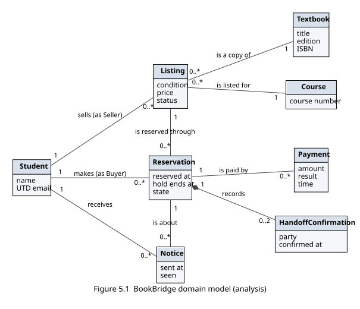

# 5.1 Domain model

Author: Steven Law (Analyst + Designer). Section 5.1 of the P2 document, BookBridge, CS 3354 Team 6.

The domain model shows what BookBridge has to know about for the use cases in 4.2 to run. Every item a Buyer or Seller supplies in an actor column of 4.2 is an attribute here (checked in 5.3, K1). It is a conceptual model only: it has no operations, data types, storage or screens, so a student who has never written code can read it.

*Figure 5.1 Domain model (conceptual classes, attributes, associations with multiplicities). Source: `docs/p2/diagrams/domain-model.dot`.*

| Class | What it represents (one line) | Key attributes | Associations (with multiplicity) |
|---|---|---|---|
| **Student** | A UTD student signed in through NetID. The same student can be the Seller of one listing and the Buyer of another. | name, UTD email | sells 0..* Listing; makes 0..* Reservation; receives 0..* Notice |
| **Listing** | A Seller’s offer of one physical copy of a course textbook (see 'Listing' in 1.3). | condition, price, status (Available, Reserved, Sold) | sold by 1 Student; is a copy of 1 Textbook; is listed for 1 Course; is reserved through 0..* Reservation |
| **Textbook** | One edition of a book, identified by its ISBN. This is what a Buyer searches for. | title, edition, ISBN | has 0..* Listing |
| **Course** | A UTD course that a listing is offered for, so Buyers can search by course (FR-04). | course number | has 0..* Listing |
| **Reservation** | A Buyer’s 10-minute hold on a listing, which becomes a paid reservation when payment succeeds (FR-06, FR-08). | reserved at, hold ends at, state (Held, Paid, Released) | made by 1 Student; for 1 Listing; is paid by 0..* Payment; records 0..2 HandoffConfirmation (composition); is the subject of 0..* Notice |
| **Payment** | BookBridge’s record of one payment attempt reported by the Payment Processor. It never holds card details (QR-03). | amount, result (Succeeded, Declined, No answer), time | for 1 Reservation |
| **HandoffConfirmation** | One party’s confirmation that the book changed hands. The listing is Sold once both exist (FR-07). | party (Seller or Buyer), confirmed at | part of 1 Reservation |
| **Notice** | A message the system leaves for a student, such as a new reservation for the Seller (FR-09). | sent at, seen | received by 1 Student; is about 1 Reservation |

**What the model revealed:** the word “book” was doing two jobs. A Textbook is an edition, which a Buyer searches for by title or ISBN (FR-04). A Listing is the one physical copy a Seller offers, and only the Listing has a condition, a price and a status (see 'Listing' in 1.3). Many listings can be copies of the same textbook, so we modelled them as two classes rather than one.

**What stays outside:** the Payment Processor and UTD NetID are external systems, not classes (CON-01, CON-02). Payment is BookBridge’s own record of the result the Payment Processor reports, so there is nowhere in the model to put a card number (QR-03).

**What must always be true:** a listing has at most one Reservation in the Held or Paid state at a time (QR-05). A Paid reservation is what makes the listing Reserved, and two HandoffConfirmations, one from the Seller and one from the Buyer, are what make it Sold (FR-07).

## Working note for 5.3 (K1): actor-column items and where they live

| Use case step | Item the actor supplies | Attribute in the domain model |
|---|---|---|
| UC-01 (3) | course | Course.course number |
| UC-01 (3) | title, edition, ISBN | Textbook.title, edition, ISBN |
| UC-01 (3) | condition, price | Listing.condition, price |
| UC-03 (1) | asks to reserve the listing | Reservation (reserved at, hold ends at) |
| UC-03 (3) | agrees to pay | Payment.amount |
| UC-03 (5) | payment details | None, by design: given to the Payment Processor outside the boundary (QR-03) |
| UC-04 (1), (3) | reports the handover, confirms | HandoffConfirmation.party, confirmed at |
