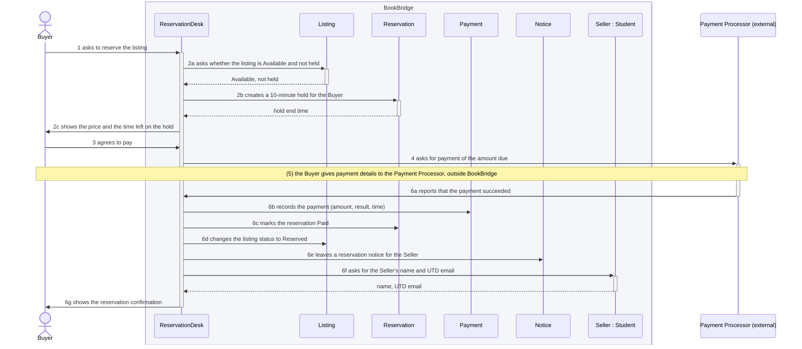
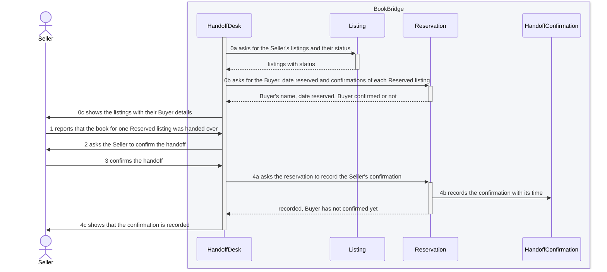

# 5.2 Object interaction models

## 5.2.1 UC-03 Reserve and Pay for a Listing

**(a) Non-trivial steps.** Steps (2), (4) and (6) need objects inside the system. Step (2) checks that the listing is still free and places the hold, step (4) asks the Payment Processor for payment, and step (6) records the payment, reserves the listing, leaves the Seller a notice and fetches the Seller’s contact details.

The other steps are trivial. Step (0) shows the listing the Buyer already opened in UC-02. Steps (1) and (3) are the Buyer’s inputs, so they appear only as the messages that start the work. Step (5) happens between the Buyer and the Payment Processor, outside BookBridge. Step (7) is the Buyer reading the confirmation.

ReservationDesk is an interaction object: the part of BookBridge that runs one reservation for the Buyer, and it is in control of the whole interaction. The Payment Processor is an external system outside the boundary (CON-02). Every other object is a class from 5.1.

**(b) Scenario table.**

| Step | Subject (who acts) | Subject action (what it does) | Other data / objects (what is used) | Object acted upon (who receives) |
|---|---|---|---|---|
| 1 | Buyer | asks to reserve the listing | the listing | ReservationDesk |
| 2a | ReservationDesk | asks whether the listing is Available and not held | the listing | Listing |
| 2b | ReservationDesk | creates a 10-minute hold for the Buyer | the Buyer, hold ends at | Reservation |
| 2c | ReservationDesk | shows the price and the time left on the hold | price, hold ends at | Buyer |
| 3 | Buyer | agrees to pay | none | ReservationDesk |
| 4 | ReservationDesk | asks for payment of the amount due | amount | Payment Processor |
| 6a | Payment Processor | reports that the payment succeeded | amount, result | ReservationDesk |
| 6b | ReservationDesk | records the payment | amount, result, time | Payment |
| 6c | ReservationDesk | marks the reservation Paid | state | Reservation |
| 6d | ReservationDesk | changes the listing status to Reserved | status | Listing |
| 6e | ReservationDesk | leaves a reservation notice for the Seller | the reservation | Notice |
| 6f | ReservationDesk | asks for the Seller’s name and UTD email | the Seller | Student (Seller) |
| 6g | ReservationDesk | shows the reservation confirmation | title, price paid, Seller’s name and UTD email | Buyer |

**(c) Analysis sequence diagram.**

*Figure 5.2.1 Analysis sequence diagram for UC-03; message numbers match the scenario table. Source: `docs/p2/diagrams/sd-uc03.mmd`.*

## 5.2.2 UC-04 Confirm Handoff

**(a) Non-trivial steps.** Steps (0) and (4) need objects inside the system. Step (0) fetches the Seller’s listings and, for each Reserved one, the Buyer, the date reserved and whether the Buyer has confirmed. Step (4) records the Seller’s confirmation.

The other steps are trivial. Steps (1) and (3) are the Seller’s inputs, so they appear only as the messages that start the work. Step (2) shows details the system already fetched at step (0). Step (5) is the Seller reading the confirmation.

HandoffDesk is an interaction object: the part of BookBridge that runs a handoff confirmation for the Seller, and it is in control of the whole interaction. Every other object is a class from 5.1.

**(b) Scenario table.**

| Step | Subject (who acts) | Subject action (what it does) | Other data / objects (what is used) | Object acted upon (who receives) |
|---|---|---|---|---|
| 0a | HandoffDesk | asks for the Seller’s listings and their status | the Seller | Listing |
| 0b | HandoffDesk | asks for the Buyer, date reserved and confirmations of each Reserved listing | the Reserved listings | Reservation |
| 0c | HandoffDesk | shows the listings with their Buyer details | status, Buyer’s name, date reserved, whether the Buyer has confirmed | Seller |
| 1 | Seller | reports that the book for one Reserved listing was handed over | the listing | HandoffDesk |
| 2 | HandoffDesk | asks the Seller to confirm the handoff | title, Buyer’s name, price paid | Seller |
| 3 | Seller | confirms the handoff | none | HandoffDesk |
| 4a | HandoffDesk | asks the reservation to record the Seller’s confirmation | party (Seller) | Reservation |
| 4b | Reservation | records the confirmation with its time | party, confirmed at | HandoffConfirmation |
| 4c | HandoffDesk | shows that the confirmation is recorded | confirmed at, listing stays Reserved | Seller |

**(c) Analysis sequence diagram.**

*Figure 5.2.2 Analysis sequence diagram for UC-04; message numbers match the scenario table. Source: `docs/p2/diagrams/sd-uc04.mmd`.*
